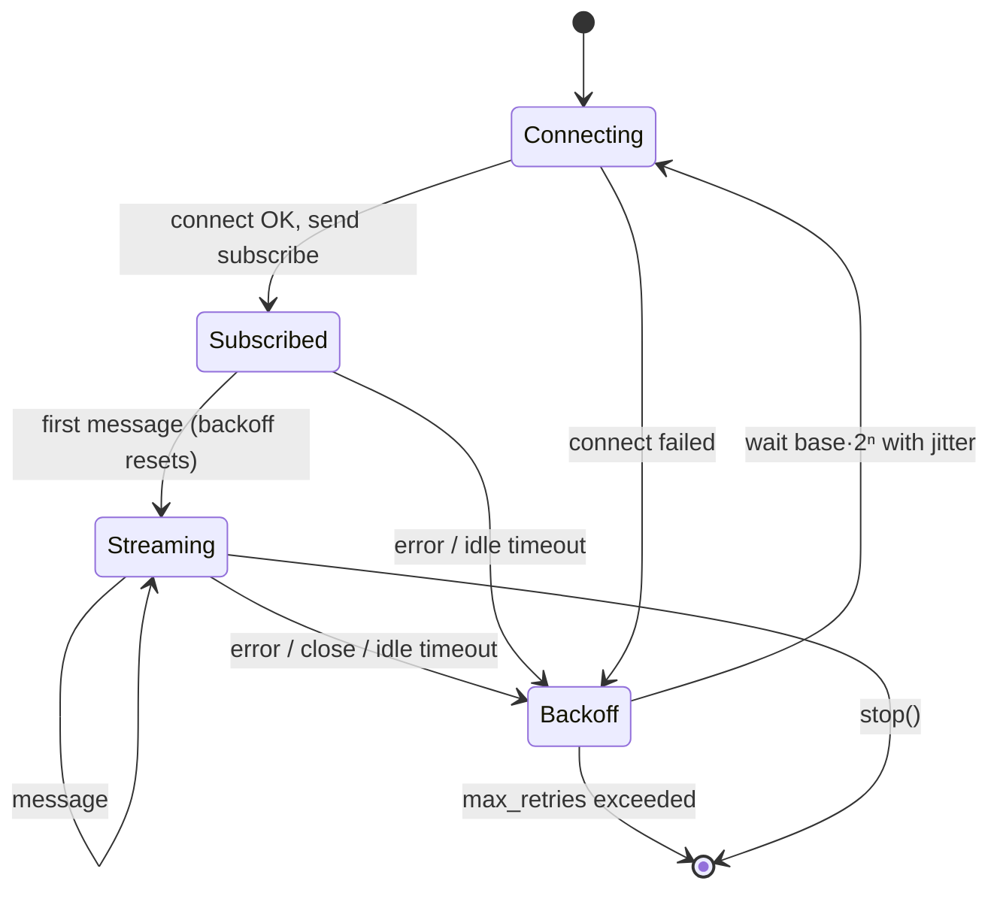

# ws-resilient


A small WebSocket client for things that must **stay connected**: market-data feeds, bots, dashboards. It reconnects with exponential backoff and jitter, notices connections that die silently, resubscribes on every reconnect, and tells you when messages were lost.

```python
import asyncio
from ws_resilient import ResilientWebSocket

async def main():
    ws = ResilientWebSocket(
        "wss://example.com/feed",
        subscribe=['{"op": "subscribe", "channel": "ticker"}'],
        idle_timeout=15,
    )
    async for message in ws.messages():
        print(message)

asyncio.run(main())
```

## Why

A plain `async for msg in websockets.connect(...)` loop handles the happy path. Production feeds also need:

| Problem | What `ws-resilient` does |
|---|---|
| Server drops you | Reconnects with exponential backoff + jitter |
| Connection looks open but is dead | `idle_timeout` forces a reconnect |
| Reconnect storms | Jitter spreads clients out; backoff resets only after real data arrives |
| Lost subscriptions | Re-sends your `subscribe` messages on every connection |
| Silent data loss | `SequenceTracker` flags gaps and duplicates in consecutive ids |
| Shutdown hangs | `stop()` interrupts a blocked read or a backoff wait immediately |
| Hard to test | Inject a fake connector and `sleep`; no network needed |

## How it works



## Install

```bash
pip install git+https://github.com/sergiogoqui-cpu/ws-resilient.git
```

Requires Python 3.10+ and `websockets`.

## Usage

### Detect lost messages

Feeds with consecutive ids (trade ids, update ids) let you know exactly when data went missing. Reset the tracker on reconnect: whatever happened in between is unknown.

```python
import json
from ws_resilient import ResilientWebSocket, SequenceTracker, SeqStatus

tracker = SequenceTracker()
ws = ResilientWebSocket("wss://example.com/trades", on_connect=tracker.reset)

async for raw in ws.messages():
    result = tracker.observe(json.loads(raw)["id"])
    if result.status is SeqStatus.GAP:
        print(f"lost {result.lost} messages: refetch or mark data as incomplete")
```

### Tune the backoff

```python
from ws_resilient import Backoff, ResilientWebSocket

ws = ResilientWebSocket(
    "wss://example.com/feed",
    backoff=Backoff(base=0.5, maximum=30, factor=2, jitter="full"),
    max_retries=10,  # raise MaxRetriesExceeded after 10 attempts with no data
)
```

### Observe it

```python
ws = ResilientWebSocket(
    "wss://example.com/feed",
    on_connect=lambda: print("up"),
    on_disconnect=lambda err: print("down:", err),
)
print(ws.stats)  # connects, reconnects, messages, idle_timeouts, errors, last_error
```

### Stop cleanly

```python
async def run():
    async for msg in ws.messages():
        if should_quit(msg):
            ws.stop()  # returns promptly, even if the socket is silent
```

### Use another transport or test without network

Anything with async `send` and `recv` works, wrapped in an async context manager:

```python
ws = ResilientWebSocket(connect=my_connector, sleep=fake_sleep)
```

See [`tests/test_client.py`](tests/test_client.py) for scripted fake connections.

## API

| Name | Purpose |
|---|---|
| `ResilientWebSocket(url, *, subscribe, idle_timeout, backoff, max_retries, on_connect, on_disconnect, connect, sleep)` | The client. `messages()` is an async iterator; `stop()` ends it; `stats` holds counters |
| `Backoff(base, maximum, factor, jitter)` | Delay policy: `"full"`, `"equal"` (default) or `"none"` jitter |
| `SequenceTracker(step=1)` | `observe(seq)` returns `FIRST`, `OK`, `DUPLICATE` or `GAP` with `lost` |
| `MaxRetriesExceeded` | Raised when consecutive attempts keep failing |

## Development

```bash
pip install -e . pytest ruff mypy
pytest
ruff check . && mypy
```

## License

MIT. Contributions and issues are welcome.
